<p align="center">
  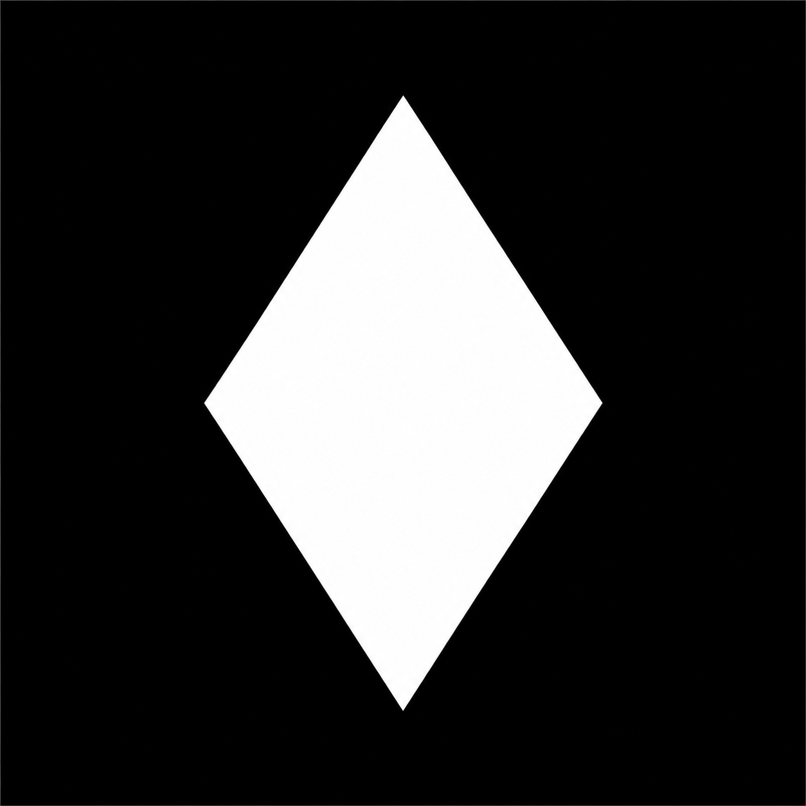
</p>

<h1 align="center">Witch Launcher</h1>

<p align="center">
<strong>Minecraft: Java Edition su iPhone e iPad.</strong><br>
Un fork iOS e iPadOS costruito dalla comunità di Amethyst, gestito da DuyAnh662 (Za_d626).
</p>

<div align="center">

[](https://github.com/Witch-Launcher/Witch_launcher/actions/workflows/development.yml)


[Caratteristiche](#features) · [Schermate](#screenshots) · [Requisiti](#requirements) · [Installazione](#installation) · [Lingue](#languages) · [Crediti](#credits) · [Licenza](#license)

<details>
<summary><strong>Lingue</strong></summary>

[Afrikaans](README.af.md) · [العربية](README.ar.md) · [azərbaycan](README.az.md) · [башҡорт теле](README.ba.md)<br>
[বাংলা](README.bn.md) · [বাংলা (ভারত)](README.bn-IN.md) · [català](README.ca.md) · [čeština](README.cs.md)<br>
[dansk](README.da.md) · [Deutsch](README.de.md) · [Ελληνικά](README.el.md) · [English](../../README.md)<br>
[English (United Kingdom)](README.en-GB.md) · [Pirate English](README.en-PT.md) · [English (Upside Down)](README.en-UD.md) · [español](README.es.md)<br>
[eesti](README.et.md) · [فارسی](README.fa.md) · [suomi](README.fi.md) · [Filipino](README.fil.md)<br>
[français](README.fr.md) · [עברית](README.he.md) · [हिन्दी](README.hi.md) · [magyar](README.hu.md)<br>
[Indonesia](README.id.md) · [italiano](README.it.md) · [日本語](README.ja.md) · [қазақ тілі](README.kk.md)<br>
[한국어](README.ko.md) · [Latin](README.la.md) · [LOLCAT](README.lol.md) · [lietuvių](README.lt.md)<br>
[Bahasa Melayu](README.ms.md) · [Nederlands](README.nl.md) · [norsk](README.no.md) · [polski](README.pl.md)<br>
[Pirate](README.pr.md) · [português](README.pt.md) · [português (Brasil)](README.pt-BR.md) · [română](README.ro.md)<br>
[русский](README.ru.md) · [slovenčina](README.sk.md) · [српски](README.sr.md) · [srpski (latinica)](README.sr-Latn.md)<br>
[svenska](README.sv.md) · [ไทย](README.th.md) · [Türkçe](README.tr.md) · [татар](README.tt.md)<br>
[українська](README.uk.md) · [Tiếng Việt](README.vi.md) · [简体中文](README.zh-Hans.md) · [繁體中文](README.zh-Hant.md)

</details>

</div>

---

<a id="about"></a>
## Circa

**Witch Launcher** è un fork indipendente di [Amethyst](https://github.com/AngelAuraMC/Amethyst-iOS) gestito dalla comunità che porta **Minecraft: Java Edition** a iPhone e iPad. Combina un'interfaccia utente di avvio touch-first con un gestore runtime completo Java, LWJGL, e uno stack grafico costruito attorno ai livelli di traduzione Metal, MoltenVK e OpenGL.

Witch si basa sul lavoro di [Boardwalk](https://github.com/zhuowei/Boardwalk), della comunità [PojavLauncher](https://github.com/PojavLauncherTeam), Amethyst-iOS e Amethyst-iOS-25. È un progetto indipendente e non è affiliato con Mojang Studios, Microsoft o con il team a monte Amethyst.

> **Versione corrente:** 0.0.4 · Vedi [`news.md`](../../news.md) per le note sulla versione.

---

<a id="features"></a>
## Caratteristiche

### Minecraft e mod

- Esegue la maggior parte delle versioni **Minecraft: Java Edition**, dalle prime versioni Beta fino agli snapshot più recenti.
- Supporta **Vaniglia, Fabric, Quilt, Forge, NeoForge e OptiFine**.
- Crea **profili di gioco** isolati con le proprie impostazioni, mod, shader, pacchetti di risorse e mondi.
- Sfoglia e installa i contenuti da **Modrinth e CurseForge** senza uscire dal launcher:
  - mod
  - modpack
  - pacchetti shader
  - pacchetti di risorse
  - mappe e mondi avventurosi
- Risolvi e installa le dipendenze della mod dove la fonte le fornisce.
- Importa i JAR del programma di installazione Forge/NeoForge e installa i caricatori Fabric/Quilt direttamente dal selettore di versione.

### Grafica e prestazioni

- Passa tra più renderer da **Impostazioni → Renderer e visualizzazione**:
  - **gl4es**: percorso di compatibilità OpenGL 2.1
  - **ANGLE**: da OpenGL ES a Metal o Vulkan
  - **MobileGlues** — OpenGL 4.0, Minecraft 1.17+, sperimentale
  - **Zink** — da OpenGL da 4.1 a Mesa 25 e MoltenVK
  - **LTW** — da OpenGL 3.3 a OpenGL ES/Metal, Minecraft 1.17+, sperimentale
  - **TGLMT** - da OpenGL 4.6 Core a Metal, A11 Bionic o successivo
- **TGLMT con supporto Sodium e Iris** per moderne configurazioni basate su shader.
- **Generazione di fotogrammi** con GPU Motion-Adaptive (MADI) e modalità Camera 3D Reproject, inclusa l'interpolazione temporale e l'estrapolazione predittiva.
- Ridimensionamento della risoluzione, framerate massimo, FSR 1.0 upscaling, cache dello shader GLSL e regolazione per renderer.
- HUD delle prestazioni con widget FPS, CPU, GPU, RAM, temperatura, batteria, orologio e FPS configurabili per la generazione di frame.
- Registrazione delle performance integrata con grafici, PNG/PDF esportazione e condivisione.

### Controlli

- Layout dei controlli su schermo, dimensioni dei pulsanti e trasparenza completamente personalizzabili.
- Supporto per **tastiera e mouse**, incluso un mouse virtuale e velocità del puntatore regolabile.
- Supporto per **controller di gioco** con layout e sensibilità configurabili.
- Puntamento **giroscopio** con sensibilità regolabile e inversione dell'asse.
- Gesti del mouse, di scorrimento e della barra di scelta rapida.
- Comportamento opzionale: tocca per posizionare i blocchi, tieni premuto per rompere i blocchi.
- Tocca due volte la barra di scelta rapida per scambiare l'oggetto trattenuto nella mano secondaria.
- Barra di scelta rapida scorrevole e tempi di pressione prolungata regolabili.

### Launcher e account

- Supporto per account **Microsoft**, **locale/offline**, **demo** e **Ely.by**.
- Gestisci **Java 8, 17, 21 e 25** runtime, scaricali in-app o importane di tuoi.
- Seleziona le versioni LWJGL e ottimizza gli argomenti JVM, le variabili di ambiente e l'allocazione della memoria.
- Gestione automatica della RAM per dispositivi con memoria limitata.
- Temi, colori principali, sfocatura, bordi, raggio degli angoli, caratteri di avvio personalizzati e icone delle app.
- **F3 informazioni sul dispositivo** nel gioco: chip del dispositivo, versione iOS, nome/versione del programma di avvio, numero di build e tipo di build.
- Integrazioni facoltative **Witch Server**, CurseForge e AI per configurazioni avanzate.
- **52 lingue in-app**, inclusi pacchetti di lingue da destra a sinistra e lingue divertenti.

---

<a id="screenshots"></a>
## Schermate

Schermate da una build di sviluppo di Witch Launcher 0.0.4. L'interfaccia può cambiare tra versioni e temi.

| | |
|---|---|
| 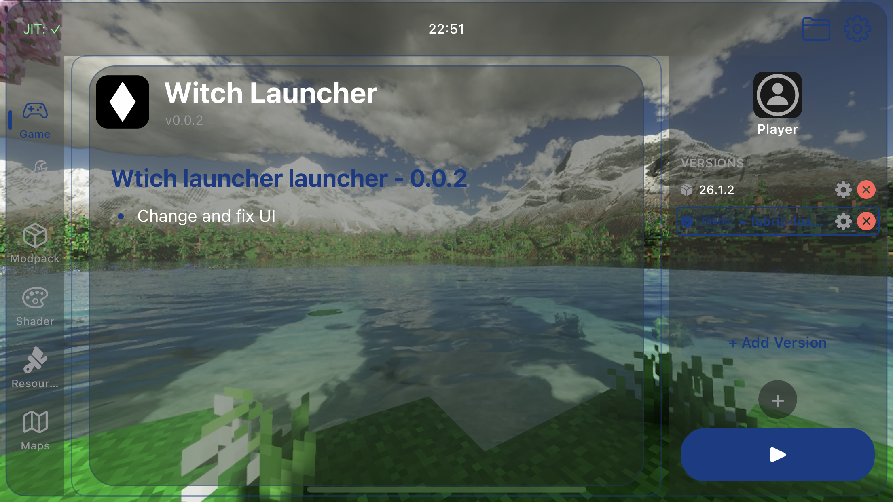 | 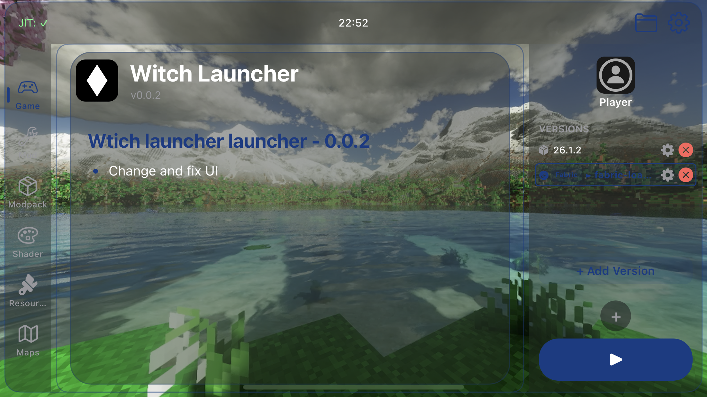 |
| 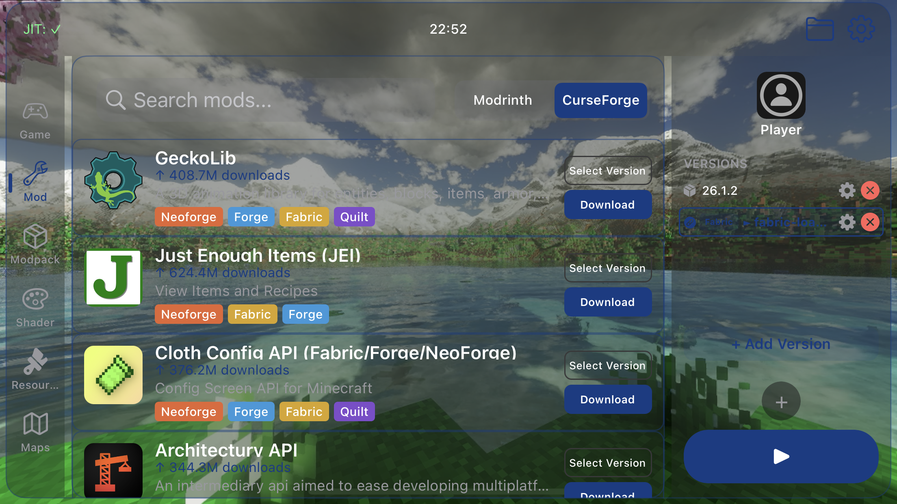 | 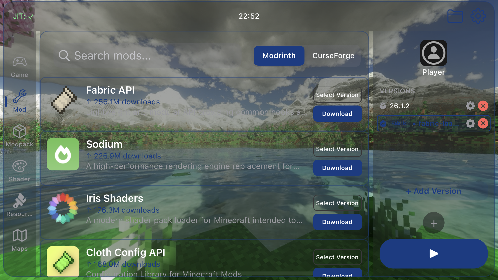 |
| 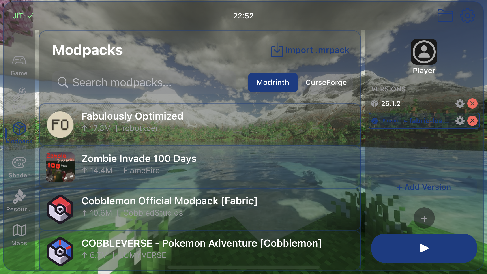 | 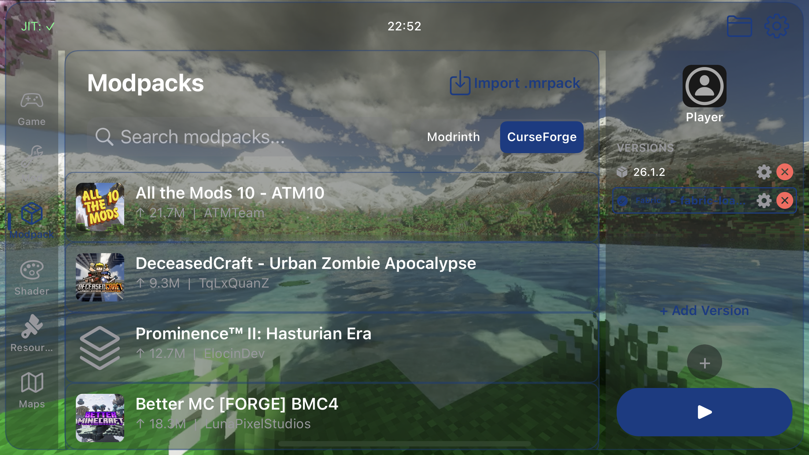 |
| 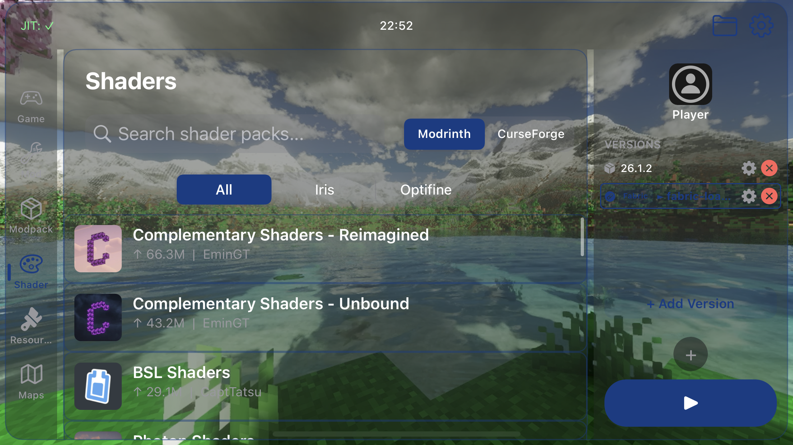 | 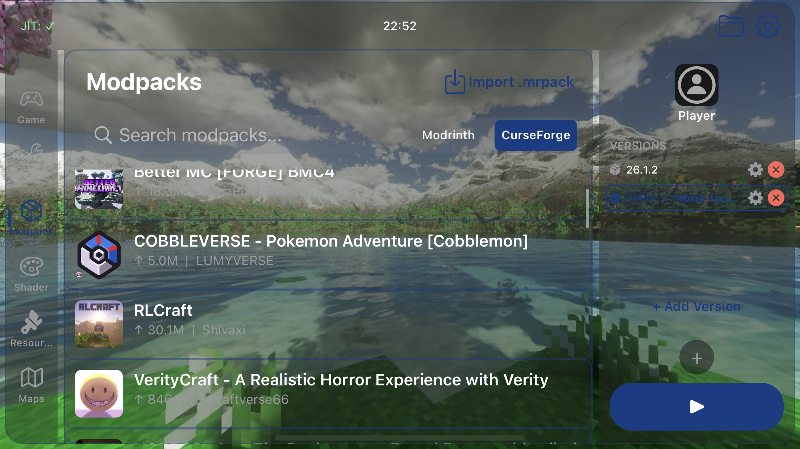 |
| 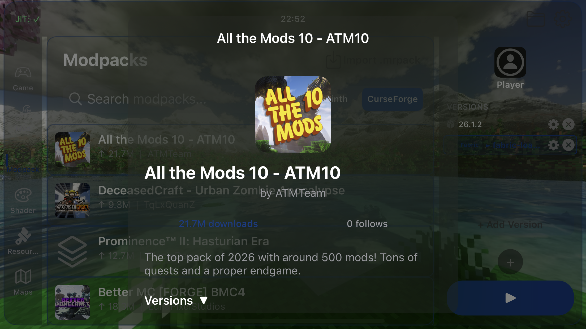 | 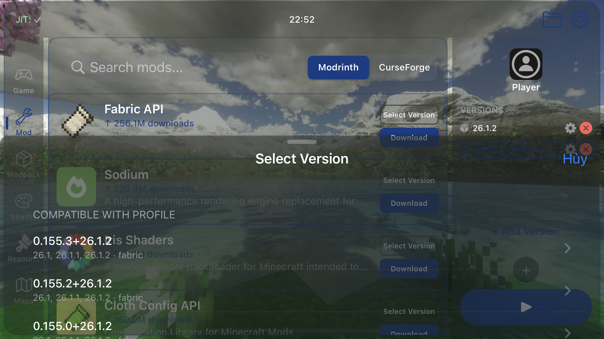 |
| 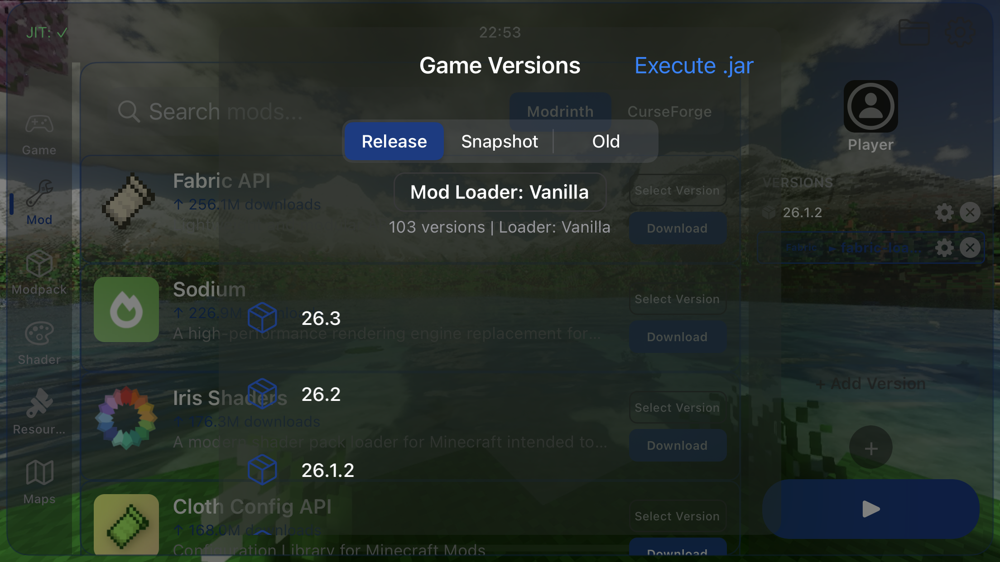 | 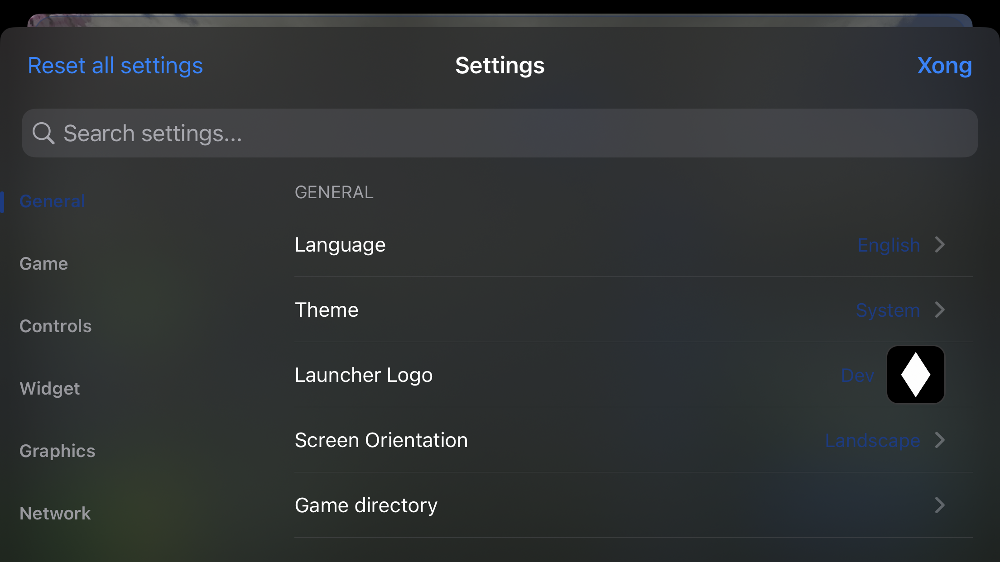 |
| 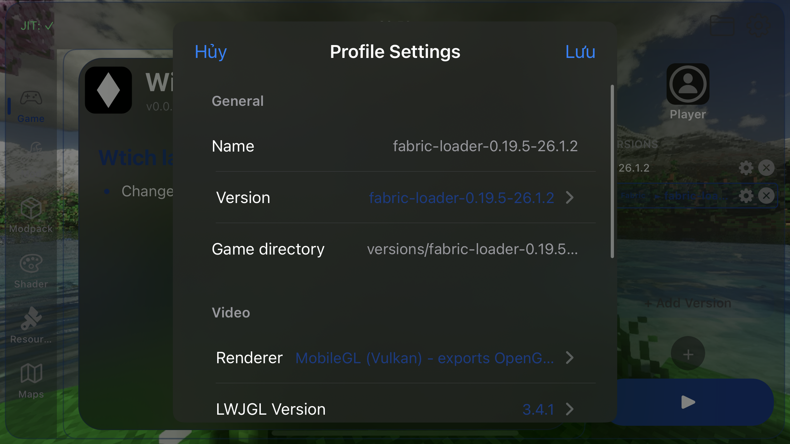 | 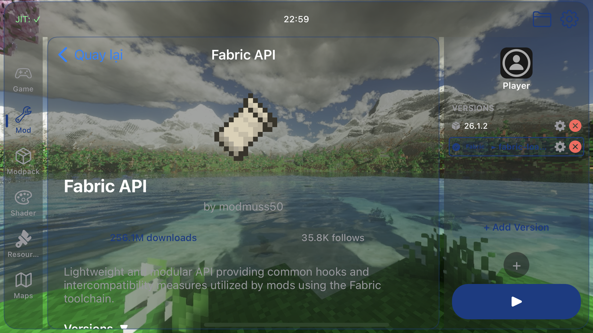 |

---

<a id="requirements"></a>
## Requisiti

| Requisito | Dettagli |
|---|---|
| **Dispositivo** | iPhone o iPad con un processore arm64 e supporto Metal |
| **Sistema** | iOS o iPadOS **14.0 o versione successiva** |
| **JIT** | Necessario. Abilita da JIT a StikDebug, SideStore, TrollStore o una configurazione con jailbreak |
| **Conto** | Un account Microsoft che possiede Minecraft per i download ufficiali; sono disponibili anche le modalità locale e demo |
| **Archiviazione** | Spazio per il launcher, Java runtime, versioni del gioco, mod e mondi |
| **Rete** | Necessario per l'accesso, il download della versione, il browser dei contenuti e i servizi online opzionali |

Witch **non** include Minecraft file di gioco. I file di gioco vengono scaricati tramite il programma di avvio dopo aver effettuato l'accesso a un account idoneo.

### JIT note

Minecraft: Java Edition ha bisogno di JIT e Witch non può avviare il gioco senza di esso.

- **Installazioni in stile SideStore/AltStore:** abilita JIT per Witch e mantieni attiva la connessione VPN/debugger richiesta. Il messaggio in-app fa riferimento a **LocalDevVPN** e `CS_DEBUGGED`.
- **StikDebug:** collega StikDebug a Witch e abilita JIT. Il **iOS 26/27**, StikDebug deve rimanere collegato mentre il gioco è in corso. `UniversalJIT26.js` viene copiato negli appunti quando necessario.
- **TrollStore:** abilita **URL Scheme** in TrollStore se Witch continua ad aspettare JIT.
- **Dispositivi con jailbreak:** utilizza il tuo attivatore JIT preferito.
- Se il programma di avvio rimane nella schermata **In attesa di JIT**, controlla la connessione del debugger, l'impostazione VPN e TrollStore URL Scheme prima di riavviare.

Il comportamento di JIT dipende dalla versione iOS e dal metodo di installazione. Gli aggiornamenti di sistema possono interrompere le configurazioni JIT esistenti.

---

<a id="installation"></a>
## Installazione

Witch deve essere firmato per il tuo dispositivo. Questo repository non fornisce certificati o IPA prefirmati.

### Usa una build

1. Scarica una build di sviluppo dal [flusso di lavoro di sviluppo](https://github.com/Witch-Launcher/Witch_launcher/actions/workflows/development.yml) oppure utilizza una build firmata da una fonte di cui ti fidi.
2. Firma e installalo con **SideStore**, **AltStore**, **TrollStore** o il tuo metodo di sideloading preferito.
3. Abilita JIT come descritto sopra prima di avviare il gioco.

Le build TrollStore utilizzano diritti aggiuntivi e non devono essere installate con un normale firmatario di sideload.

### Costruisci dalla fonte

La compilazione di Witch richiede macOS con gli strumenti da riga di comando Xcode, iOS SDK 14.0 o versione successiva, CMake, JDK 8, `ldid`, `wget`, `zip` e Git.

```bash
git clone --recursive https://github.com/Witch-Launcher/Witch_launcher.git
cd Witch_launcher
make jre-download
make -j"$(sysctl -n hw.ncpu)" package
```

Le build pacchettizzate vengono scritte in `artifacts/`.

Per creare invece un pacchetto TrollStore:

```bash
make package TROLLSTORE_JIT_ENT=1
```

Per i collegamenti ai sorgenti del renderer e le note di creazione, vedere [`note.md`](../../note.md).

---

<a id="languages"></a>
## Lingue

Witch Launcher viene fornito con **52 pacchetti di lingue**. Apri **Impostazioni → Generali → Lingua** e seleziona una lingua oppure utilizza **Auto** per seguire la lingua del dispositivo.

| Code | Language | Code | Language |
|---|---|---|---|
| `af` | [Afrikaans](README.af.md) | `ar` | [العربية](README.ar.md) |
| `az` | [azərbaycan](README.az.md) | `ba` | [башҡорт теле](README.ba.md) |
| `bn` | [বাংলা](README.bn.md) | `bn-IN` | [বাংলা (ভারত)](README.bn-IN.md) |
| `ca` | [català](README.ca.md) | `cs` | [čeština](README.cs.md) |
| `da` | [dansk](README.da.md) | `de` | [Deutsch](README.de.md) |
| `el` | [Ελληνικά](README.el.md) | `en` | [English](../../README.md) |
| `en-GB` | [English (United Kingdom)](README.en-GB.md) | `en-PT` | [Pirate English](README.en-PT.md) |
| `en-UD` | [English (Upside Down)](README.en-UD.md) | `es` | [español](README.es.md) |
| `et` | [eesti](README.et.md) | `fa` | [فارسی](README.fa.md) |
| `fi` | [suomi](README.fi.md) | `fil` | [Filipino](README.fil.md) |
| `fr` | [français](README.fr.md) | `he` | [עברית](README.he.md) |
| `hi` | [हिन्दी](README.hi.md) | `hu` | [magyar](README.hu.md) |
| `id` | [Indonesia](README.id.md) | `it` | [italiano](README.it.md) |
| `ja` | [日本語](README.ja.md) | `kk` | [қазақ тілі](README.kk.md) |
| `ko` | [한국어](README.ko.md) | `la` | [Latin](README.la.md) |
| `lol` | [LOLCAT](README.lol.md) | `lt` | [lietuvių](README.lt.md) |
| `ms` | [Bahasa Melayu](README.ms.md) | `nl` | [Nederlands](README.nl.md) |
| `no` | [norsk](README.no.md) | `pl` | [polski](README.pl.md) |
| `pr` | [Pirate](README.pr.md) | `pt` | [português](README.pt.md) |
| `pt-BR` | [português (Brasil)](README.pt-BR.md) | `ro` | [română](README.ro.md) |
| `ru` | [русский](README.ru.md) | `sk` | [slovenčina](README.sk.md) |
| `sr` | [српски](README.sr.md) | `sr-Latn` | [srpski (latinica)](README.sr-Latn.md) |
| `sv` | [svenska](README.sv.md) | `th` | [ไทย](README.th.md) |
| `tr` | [Türkçe](README.tr.md) | `tt` | [татар](README.tt.md) |
| `uk` | [українська](README.uk.md) | `vi` | [Tiếng Việt](README.vi.md) |
| `zh-Hans` | [简体中文](README.zh-Hans.md) | `zh-Hant` | [繁體中文](README.zh-Hant.md) |

L'app fornisce tutti i **52 pacchetti di lingue**. Le traduzioni README sono disponibili per **tutte le 52 lingue**, incluso l'inglese.

Alcune traduzioni sono assistite da un computer e possono contenere termini tecnici scomodi. Le correzioni sono benvenute.

L'inglese è la lingua di origine di questo file README. I README localizzati sono disponibili dal selettore della lingua nella parte superiore di questa pagina e nella directory [`docs/readme/`](./).

---

<a id="notes-and-limitations"></a>
## Note e limitazioni

- **JIT è obbligatorio.** Senza una configurazione JIT funzionante, Minecraft non verrà avviato.
- **iOS 26/27 JIT è fragile.** StikDebug deve rimanere collegato e i futuri aggiornamenti del sistema operativo potrebbero modificare ciò che funziona.
- I renderer contrassegnati come **sperimentali** possono bloccarsi o essere visualizzati in modo errato. Inizia con **Auto** se non sei sicuro.
- La **generazione di frame** richiede il renderer MoltenVK e il supporto di calcolo Metal. Può aumentare l'utilizzo della batteria e la temperatura del dispositivo.
- Alcuni mod, modpack, shader e mondi potrebbero richiedere una versione Minecraft, un caricatore, un renderer o una memoria aggiuntiva specifici.
- I CurseForge modpack utilizzano `manifest.json`; se l'installazione con un tocco non è disponibile per un pacchetto, importa l'archivio manualmente.
- Le funzionalità online dipendono da servizi di terze parti e potrebbero non essere disponibili.
- Gli screenshot provengono da una build di sviluppo e potrebbero non corrispondere esattamente alla versione corrente.

---

<a id="project-lineage"></a>
## Discendenza del progetto

```text
Boardwalk
    │
    └── PojavLauncherTeam
        │
        └── AngelAuraMC
            │
            └── Amethyst-iOS
                │
                └── Amethyst-iOS-25 (fork by Catsruledogs)
                    │
                    └── Witch Launcher
                        └── iOS / iPadOS
```

### Progetti correlati

- [AmethystAndroid](https://github.com/AngelAuraMC/Amethyst-Android)
- [Amethyst-iOS](https://github.com/AngelAuraMC/Amethyst-iOS)
- [Amethyst-iOS-25](https://github.com/catsruledogs/Amethyst-iOS-25)
- [Boardwalk](https://github.com/zhuowei/Boardwalk)
- [PojavLauncher](https://github.com/PojavLauncherTeam)

---

<a id="contributing"></a>
## Contribuire

Segnalazioni di bug e PR sono benvenuti. Quando segnali un problema, includi:

- modello del dispositivo e versione iOS/iPadOS.
- Witch Launcher versione
- renderer e la versione Minecraft.
- caricatore di mod e un elenco di mod installate
- passaggi per riprodursi
- il relativo registro o rapporto sugli arresti anomali

Non impegnarti a firmare certificati, profili di provisioning, chiavi API o altri segreti.

---

<a id="credits"></a>
## Crediti

**Witch Launcher** è gestito da **DuyAnh662 (Za_d626)**.

- [TikTok](https://tiktok.com/@za_d626)
- [YouTube](https://youtube.com/@za_d626)
- [X](https://x.com/duyanh662)

### A monte e comunitario

Witch Launcher e i suoi progetti a monte si basano sul lavoro di molti contributori, tra cui:

- **@crystall1nedev** — Amethyst project manager e iOS sviluppatore di port
- **@khanhduytran0** — iOS sviluppatore del port
- **@artdeell**
- **@Mathius-Boulay**
- **@zhuowei**
- **@jkcoxson**
- **@Diatrus**
- **@Catsruledogs**
- **@T1k-T1k**

Ulteriori ringraziamenti a **@lunixbochs**, **@ptitSeb**, **@kakashidinho**, il ANGLE Project, Khronos Group, Mesa Project, PojavLauncher Team, Mozilla e la Minecraft community.

Un ringraziamento speciale a [MCHeads](https://mc-heads.net) per aver fornito i servizi avatar Minecraft.

L'elenco completo dei componenti di terze parti e delle licenze è disponibile in [`credits.md`](../../credits.md).

---

<a id="license"></a>
## Licenza

Witch Launcher è distribuito sotto la **GNU General Public License v3.0**, soggetto alle licenze e ai requisiti di copyright dei componenti di terze parti elencati in [`credits.md`](../../credits.md).

Vedere [`LICENSE`](../../LICENSE) per il testo completo della licenza.

---

<p align="center">
<sub>Minecraft è un marchio di Mojang Studios. Witch Launcher non è affiliato con Mojang Studios, Microsoft o con il progetto Amethyst.</sub>
</p>
